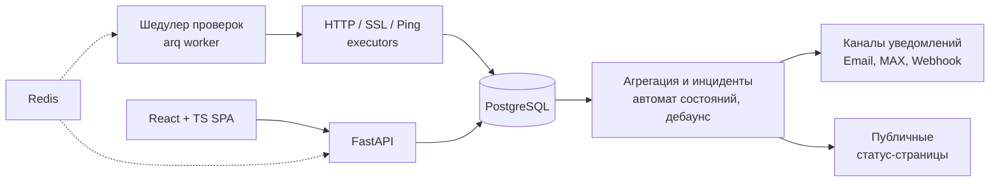

# FideVisio — мониторинг сайтов

**Российский сервис [мониторинга сайтов](https://fidevisio.ru):** HTTP-проверки
каждые 30–60 секунд с серверов в РФ (доступность, скорость и содержимое — ловит
случай «код 200, но сайт лежит»), SSL-сертификаты с предупреждением за 14/7/3 дня,
Ping. Алерты в Email, MAX и Webhook — одно сообщение на инцидент. Публичные
статус-страницы. Первый месяц бесплатно, далее от 90 ₽/мес.

[Сайт](https://fidevisio.ru) · [Тарифы](https://fidevisio.ru/pricing) ·
[Помощь](https://fidevisio.ru/help)


> **Исходники приватны** (коммерческая логика и IP): в этом репозитории — как
> сервис устроен, какие инженерные решения приняты, и **готовые примеры
> интеграций** (webhook-алерты и публичный JSON API статус-страниц).

## Архитектура



<!-- Скриншоты (замазать реальные домены): дашборд с мониторами, карточка
     инцидента, пример алерта. -->

## Инженерные решения

- **Одно сообщение на инцидент.** Алерты агрегируются: все упавшие проверки
  одного простоя → одно письмо/сообщение, а не письмо на каждую проверку.
- **Дебаунс флаппинга (3/3).** Кратковременные сбои не порождают ложных
  алертов: переход по симметричному порогу в обе стороны.
- **Джиттер сетки проверок (50–500 мс).** Мониторы не синхронизируются в один
  тик — нагрузка на цель распределена, тик не бьёт пачкой.
- **Контент-проверка HTTP.** Условие успеха по ключевому слову и размеру тела
  ответа: чинит «200, но сайт отдаёт заглушку».
- **SSL-expiry скан** — предупреждение за 14, 7 и 3 дня до истечения.
- **Границы кода enforce-ятся:** импорт-контракты «продукт → только ядро»,
  единая цепочка миграций, строгая типизация (mypy strict) в CI.

---

# Примеры интеграций

- **Webhook-алерты** — FideVisio отправляет `POST` с подписью `X-Signature`
  (HMAC-SHA256 от тела запроса). Ниже: приёмники на Python и Node.js с проверкой
  подписи.
- **JSON API статус-страниц** — публичный эндпоинт без авторизации, удобен для
  Grafana (JSON datasource), своих виджетов и скриптов.
- `schema/alert-event.schema.json` — JSON Schema события алерта.

## Webhook: payload и подпись

```http
POST /your-endpoint HTTP/1.1
Content-Type: application/json
X-Signature: sha256=<hex hmac-sha256 от сырых байт тела>
```

Тело запроса (полная схема — `schema/alert-event.schema.json`):

```json
{
  "provider": "webhook",
  "timestamp": "2026-10-16T12:00:00+00:00",
  "event": {
    "event_type": "down",
    "incident_id": "3f1c9e2a-0b7d-4c8e-9a11-6d2f5b0c7e44",
    "monitor_name": "Пример сайта",
    "monitor_url": "https://example.com",
    "check_kind": "http",
    "error_detail": "Connection timed out",
    "detected_at": "2026-10-16T11:59:30+00:00",
    "dashboard_url": "https://fidevisio.ru/dashboard/monitors/42"
  }
}
```

Проверяйте подпись **по сырым байтам тела** до парсинга JSON.

### Python (только стандартная библиотека)

```python
# examples/receiver_python.py
import hashlib, hmac, json, os
from http.server import BaseHTTPRequestHandler, HTTPServer

SECRET = os.environ["FIDEVISIO_WEBHOOK_SECRET"].encode()


class Handler(BaseHTTPRequestHandler):
    def do_POST(self) -> None:
        raw = self.rfile.read(int(self.headers.get("Content-Length", 0)))
        expected = "sha256=" + hmac.new(
            SECRET, raw, digestmod=hashlib.sha256
        ).hexdigest()
        if not hmac.compare_digest(expected, self.headers.get("X-Signature", "")):
            self.send_response(401)
            self.end_headers()
            return
        event = json.loads(raw)["event"]
        print(
            f"{event['event_type']}: {event['monitor_name']} "
            f"— {event.get('error_detail') or 'ok'}"
        )
        self.send_response(200)
        self.end_headers()
        self.wfile.write(b"ok")


HTTPServer(("0.0.0.0", 8080), Handler).serve_forever()
```

```bash
FIDEVISIO_WEBHOOK_SECRET=<секрет канала> python examples/receiver_python.py
```

### Node.js

```js
// examples/receiver_node.js
import http from "node:http";
import crypto from "node:crypto";

const secret = process.env.FIDEVISIO_WEBHOOK_SECRET;
if (!secret) throw new Error("FIDEVISIO_WEBHOOK_SECRET is not set");

http
  .createServer((req, res) => {
    if (req.method !== "POST") {
      res.writeHead(405).end();
      return;
    }

    const chunks = [];
    req.on("data", (c) => chunks.push(c));
    req.on("end", () => {
      const raw = Buffer.concat(chunks);
      const expected =
        "sha256=" +
        crypto.createHmac("sha256", secret).update(raw).digest("hex");
      const got = req.headers["x-signature"] || "";

      // timingSafeEqual требует буферы равной длины — иначе бросает исключение,
      // поэтому сначала сравниваем длины (иначе битый заголовок уронит процесс).
      const ok =
        expected.length === got.length &&
        crypto.timingSafeEqual(Buffer.from(expected), Buffer.from(got));
      if (!ok) {
        res.writeHead(401).end();
        return;
      }

      const { event } = JSON.parse(raw.toString("utf8"));
      console.log(`${event.event_type}: ${event.monitor_name}`);
      res.writeHead(200).end("ok");
    });
  })
  .listen(8080);
```

## JSON API статус-страницы

```bash
curl -H "Accept: application/json" https://fidevisio.ru/status/<slug>
```

`<slug>` — алиас публичной статус-страницы в настройках FideVisio. Без
авторизации; при `Accept: text/html` отдаётся HTML-страница, иначе JSON.

---

<details>
<summary>English</summary>

**FideVisio** — a Russian website monitoring SaaS: HTTP checks every 30–60 s from
servers in Russia (availability, speed and body content), SSL expiry alerts
(14/7/3 days), ping; Email/MAX/webhook alerts (one message per incident); public
status pages. https://fidevisio.ru

Built with FastAPI, PostgreSQL, Redis/arq, React + TypeScript. Sources are
private (commercial logic); this repo documents the architecture and ships
ready-to-use integration examples: webhook receivers (Python/Node.js) with
HMAC-SHA256 `X-Signature` verification, the alert-event JSON Schema, and the
public status JSON API (`GET https://fidevisio.ru/status/<slug>`, no auth).
</details>
